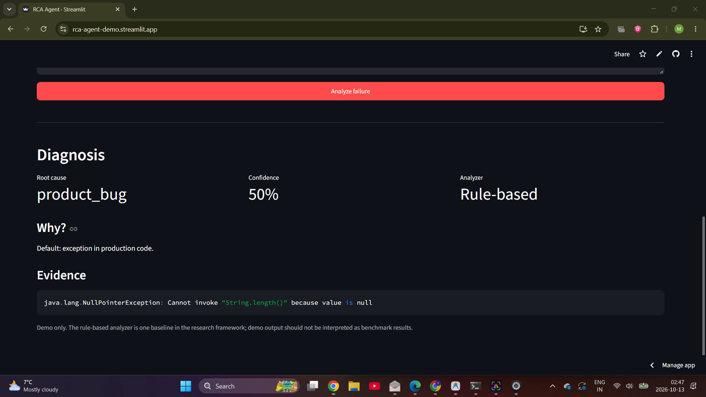

# rca-agent: root-cause analysis of test failures, rule-based vs ML vs LLM agents

An evaluation framework for one research question:

> Can a multi-agent LLM system with a verifier identify the root cause of software test failures more accurately,
> and with fewer fabricated explanations, than a rule-based baseline, a trained ML classifier, a single LLM or a RAG-augmented LLM?

It is a *measurement* project, not a product. The value is in the dataset, the labelling protocol and the evaluation, so those are
built in: leakage-aware cross-validation, manual-labelling tooling with inter-annotator agreement, bootstrap confidence intervals, paired
significance tests, and an evidence-grounding check that turns "hallucination" into a number.

### Demo

**Live demo:** https://rca-agent-demo.streamlit.app/



The demo shows the rule-based analyzer diagnosing a CI failure with its predicted root-cause category, confidence, rationale, and supporting evidence.

## Status: what is verified and what is not

| Part | Status |
|---|---|
| Harness, metrics, systems, converters, labelling tools | Implemented and covered by **30 automated tests (all pass)**. |
| Offline demo on synthetic data with the mock LLM | Runs end to end. **Pipeline check only, not a research result.** |
| Real BugSwarm integration | Verified against real BugSwarm metadata and real artifact evidence. |
| BugSwarm held-out evaluation | 20 real artifacts evaluated with the frozen rule-based RCA system. Manual coarse RCA agreement: **20/20 (100%)**; weak-label agreement: **18/20 (90.0%)** with Macro-F1 **0.919**. |
| Real LLM runs (`--llm anthropic`) | Implemented, **not run** in this evaluation. |
| Other datasets (IDoFT, GitBug-Java, LogChunks) | Converters are implemented, but they were not part of the completed held-out BugSwarm evaluation. |

The mock LLM (`--llm mock`) is a deterministic heuristic that reads the same signals as the rule-based system. Differences between systems under the mock reflect how those heuristics combine, not how language models behave. For the same reason the TF-IDF baseline scores 100% on the synthetic sample: the logs are template-generated. **Never report numbers from the synthetic sample.**

## Systems compared

|Name|What it is|LLM calls/record|
|-|-|-|
|`rule`|Rule-based RCA using build logs, history, commit/diff signals, and targeted failure heuristics.|0|
|`tfidf`|TF-IDF + logistic regression on test name, log and commit message, trained inside each fold. The *trained ML* baseline.|0|
|`single`|One prompt that sees the full case (log, history, commit, diff). A fair monolithic baseline.|1|
|`rag`|`single` plus the 3 most similar labelled failures from the training fold.|1|
|`multi`|Log analyst + history analyst + change analyst, then a lead investigator.|4|
|`multi_verifier`|`multi`, then (1) a deterministic grounding check that drops evidence not in the input, (2) a skeptical LLM reviewer that may revise the label.|5|

Root-cause taxonomy (edit `src/rca/taxonomy.py`): `product_bug`, `test_bug`, `flaky`, `environment`, `dependency_config`.


## Quick start (offline demo)

```bash
pip install -e .            # needs scikit-learn
python -m rca make-sample --n 150 --out data/sample.jsonl     # synthetic, for pipeline testing only
python -m rca run --data data/sample.jsonl --folds 5 --out results/demo
python -m unittest discover -s tests                          # or: pytest
```

`results/demo/` in this repository is the output of exactly that command, kept as an example of the report format.

## Running the real experiment

### 1\. Get the data (on your own machine)

|Dataset|Where|What you get|Converter|
|-|-|-|-|
|BugSwarm|bugswarm.org, github.com/bugswarm/bugswarm (REST API, CLI)|Failing/passing CI pairs, Java and Python; reproducible containers|`rca convert-bugswarm --json export.json --logs-dir logs/ --out data/bugswarm.jsonl`|
|GitBug-Java|github.com/gitbugactions/gitbug-java (setup needs about 130 GB: \~50 GiB image + \~80 GiB dependencies)|199 recent (2023) Java bugs from 55 repos; use as a held-out set against model memorisation|collect logs with `gitbug-java run`, then `rca convert-dir`|
|IDoFT|github.com/TestingResearchIllinois/idoft|Flaky tests with categories (OD, ID, NOD, ...); positives only, no logs|`rca convert-idoft --csv pr-data.csv --out data/idoft.jsonl`|
|LogChunks|Zenodo, DOI 10.5281/zenodo.3632351 (CC BY 4.0 on the Hugging Face copy)|797 Travis build logs from 80 repos with the labelled failure chunk|`rca convert-dir --dir logchunks/logs --source logchunks --out ...`|

Check each dataset's licence before redistributing anything derived from it.

### BugSwarm held-out evaluation

The completed evaluation uses 20 real BugSwarm artifacts selected from the
reproduced, active artifact population. The held-out cases are artifact-disjoint
from the development set, and the rule-based system was frozen before the
held-out manual RCA annotations were added.

The evaluation uses real BugSwarm metadata and failed→passed artifact diffs.
Historical build logs were not available for these cases through the available
BugSwarm log endpoint, so the held-out run was performed with empty logs. This
is an important limitation: the result measures the frozen rule system using
the available metadata and change evidence, rather than a complete historical
CI-log reconstruction.

|Metric|Result|
|-|-:|
|Weak BugSwarm-label agreement|**18/20 (90.0%)**|
|Manual coarse RCA accuracy|**20/20 (100%)**|
|Manual RCA annotations available|**20/20 (100%)**|

BugSwarm's `classification` field is a weak fix-based signal, not RCA ground
truth. The manual held-out annotations therefore provide the primary coarse
RCA validation for this experiment.

The held-out evaluation is a small validation study, not a benchmark claim.
Manual review produced 20/20 agreement with the reconstructed coarse RCA labels.
Because this validation set is small, the result should be interpreted as a
validation study rather than a benchmark-level accuracy claim.

### 2\. Label (this is where the thesis credibility comes from)

None of these datasets gives you labels in this taxonomy. BugSwarm's `classification` records what the *fix* touched, so the converter maps it to
**weak** labels only, and `flaky`/`environment` cannot be derived. Read `docs/LABELING\\\_PROTOCOL.md`, then:

```bash
python -m rca label-sheet data/bugswarm.jsonl --out sheets/a.csv        # annotator A fills the `label` column
python -m rca label-sheet data/bugswarm.jsonl --out sheets/b.csv        # annotator B labels a 20-30% sample
python -m rca kappa sheets/a.csv sheets/b.csv                           # inter-annotator agreement
python -m rca apply-labels --data data/bugswarm.jsonl --sheet sheets/a.csv --out data/bugswarm.labeled.jsonl
```

Aim for 200-500 labelled failures with a second annotator on a sample. Report Cohen's kappa in the thesis.

### 3\. Run

```bash
export ANTHROPIC\\\_API\\\_KEY=...
export RCA\\\_MODEL=claude-sonnet-5-5                  # default; any model id works
export RCA\\\_PRICE\\\_IN\\\_PER\\\_MTOK=...  RCA\\\_PRICE\\\_OUT\\\_PER\\\_MTOK=...   # USD, from Anthropic's pricing page; otherwise cost shows 0
pip install -e ".\\\[llm]"

python -m rca run --data data/bugswarm.labeled.jsonl data/gitbug.labeled.jsonl \\\\
    --llm anthropic --limit 40 --workers 4 --out results/pilot      # always pilot small first
```

The CLI prints the estimated number of LLM calls and aborts above `--max-calls` (default 3000). Responses are cached on disk
(`<out>/llm\\\_cache`), so a rerun costs nothing and gives identical numbers, which also makes the experiment reproducible.

Outputs in `--out`: `report.md` (tables), `summary.json`, `predictions.jsonl` (one row per system and record: prediction, evidence, tokens,
latency, cost, verifier notes, useful for error analysis).

## Metrics

* **Accuracy** with a 95% bootstrap CI; **macro precision / recall / F1** (macro over classes that occur in the gold labels), per-class F1, confusion matrices.
* **Paired significance**: exact McNemar test of each system against a reference (`--reference`, default `rule`) on the same records.
* **Hallucination rate**: share of cited evidence items that do not appear verbatim (whitespace/case-insensitive) in the input. It measures fabricated or
misquoted evidence, not wrong labels. Systems that cite no evidence (`tfidf`) report n/a. Because the verifier filters ungrounded evidence by design, its
rate is expected to be near zero; the interesting comparison is `multi` vs `multi_verifier` on **accuracy** and on how often the verifier changes the label.
* **Cost and latency**: mean per record, summed over all LLM calls of a system (calls within one system run sequentially, so latency is end to end).
* Invalid or unparseable model output counts as a wrong answer (`invalid`), and exceptions as `error`; both are shown in the confusion matrices.

## Experimental design notes

* **Project-grouped folds** (default): a project's failures never appear in both train and test, which avoids inflated scores from near-duplicate failures. Disable with `--no-group-by-project`.
* **Leakage**: Defects4J-style and older GitHub data are likely in LLM training data. Evaluate GitBug-Java (2023 bugs) separately and compare; a large gap suggests memorisation.
* **Information parity**: `single` and `rag` see exactly what the multi-agent system sees, so any gain is attributable to the architecture and not to extra information.
* **Prompts are fixed in `src/rca/prompts.py`**, shared by all LLM systems. Tune them on a separate development split, not on the evaluation folds.
* **History** is the prior pass/fail outcomes of the failing test (oldest to newest, current failure excluded). Real datasets rarely ship it; BugSwarm/CI data
can provide it by mining earlier runs. Without history, the history analyst contributes nothing: report that as a limitation or mine it.

## Threats to validity (put these in the write-up)

1. Label quality: weak labels, a single annotator, or low kappa undermine every number.
2. Class imbalance: real data is dominated by a few classes; read per-class F1, not only accuracy.
3. Model memorisation of public benchmarks.
4. Prompt sensitivity: report the prompt version and, ideally, repeat with a second phrasing.
5. Non-determinism: temperature 0 helps but does not guarantee identical outputs across API versions; the cache pins them for reproduction.
6. Taxonomy fit: some failures have several causes; the protocol picks the primary one.

## Layout

```
src/rca/
  taxonomy.py  schema.py          labels, FailureRecord (canonical JSONL)
  datasets/                       idoft, bugswarm, dirloader converters + synthetic sample
  systems/                        rule, tfidf, retrieval, llm\\\_systems (single, rag, multi, verifier)
  llm.py  prompts.py              Anthropic client, disk cache, mock LLM, prompts
  grounding.py  heuristics.py     evidence-grounding check, hand-written signals
  evaluate.py  metrics.py  report.py  labeling.py  cli.py
tests/test\\\_core.py                30 automated tests (all pass)
data/sample.jsonl                 synthetic sample (pipeline testing only)
results/demo/                     example report from the offline demo
docs/LABELING\\\_PROTOCOL.md
```

## Extending

* New system: subclass `System` in `systems/`, implement `diagnose`, register it in `systems/\\\_\\\_init\\\_\\\_.py`.
* New label set: edit `taxonomy.py`; prompts, metrics and reports follow.
* Self-healing follow-up (project idea #2): reuse the diagnosis as input to a patch-generation agent and verify by re-running the failing test in the reproducible container BugSwarm / GitBug-Java provide.

